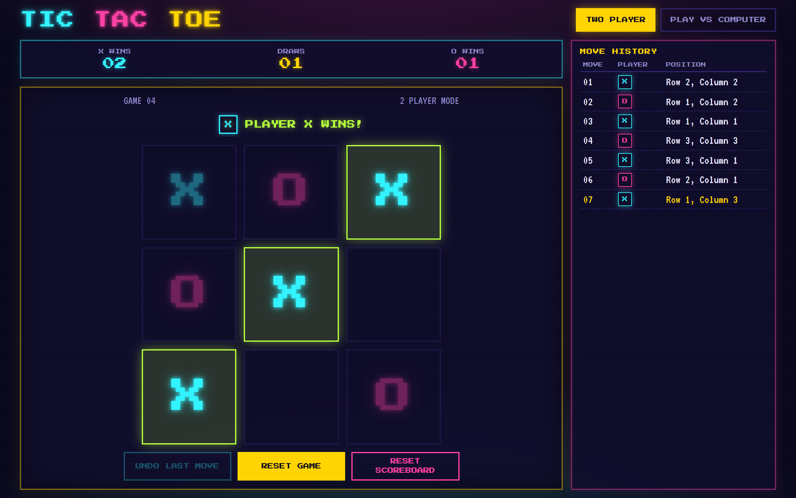
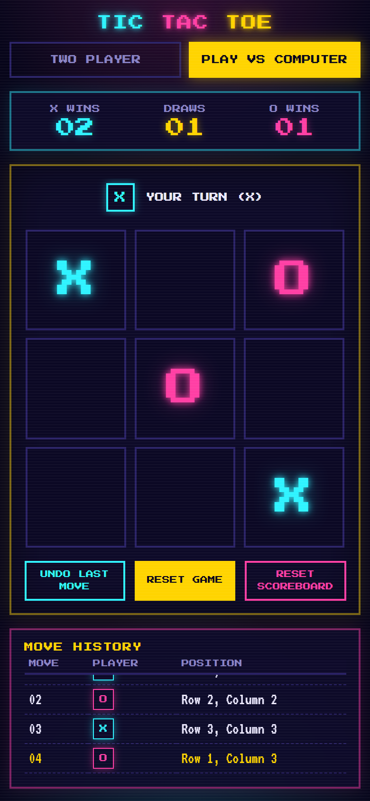

# Tic Tac Toe

[](https://github.com/nivi26-coder/ABB-tic-tac-toe-assignment/actions/workflows/deploy.yml)

**▶ [Play the live demo](https://nivi26-coder.github.io/ABB-tic-tac-toe-assignment/)**

A browser-based Tic Tac Toe game built with React. It supports two-player and play-against-computer modes, move history, undo, a session scoreboard and win/draw detection with highlighted winning cells.

All game rules and state live in the frontend. There is no backend in this submission (see [Scope](#scope)).

<p align="center">
  
  
</p>

## Tech stack

| Area               | Choice                                                                          |
| ------------------ | ------------------------------------------------------------------------------- |
| UI                 | React 19 (function components, hooks)                                           |
| State              | `useReducer` + pure game logic functions                                        |
| Build / dev server | Vite 8                                                                          |
| Tests              | Vitest 5, React Testing Library, jsdom                                          |
| Styling            | CSS Modules per component, CSS custom properties, container query units, `clsx` |
| Fonts              | `@fontsource/press-start-2p`, `@fontsource/vt323` (self-hosted, no CDN)         |
| Storage            | React state, scoreboard kept in `sessionStorage`                                |
| Code quality       | ESLint 10 (React Hooks + React Refresh rules), Prettier                         |
| CI / hosting       | GitHub Actions, GitHub Pages                                                    |

## Getting started

Requires Node.js 22 (or 20.19+).

```bash
npm install
npm run dev          # http://localhost:5173
```

Other scripts:

```bash
npm test             # run all tests once
npm run test:watch   # watch mode
npm run build        # production build into dist/
npm run preview      # serve the production build
npm run lint         # ESLint
npm run format       # format everything with Prettier
npm run format:check # check formatting without changing files
```

### Deployment

Every push to `main` runs [`.github/workflows/deploy.yml`](.github/workflows/deploy.yml). It installs dependencies, then runs lint, the format check, the tests and the production build, and publishes `dist/` to GitHub Pages. If any check fails, nothing is deployed, so the live demo always matches a passing build. Pages serves the site from `/ABB-tic-tac-toe-assignment/`, so the workflow builds with that base path; local builds are unaffected.

Imports use the `@/` alias for `src/` (for example `import Board from '@/components/Board'`). It is set up in `vite.config.js`, and `jsconfig.json` lets the editor follow it.

## Features

- 3 × 3 board. Empty cells are clickable; filled cells are locked.
- Clear turn indicator, alternating X and O after every valid move.
- Win detection for rows, columns and diagonals, with the winning cells highlighted.
- Draw detection when all nine cells are filled with no winner.
- Move history table (move number, player, `Row r, Column c`).
- Undo Last Move:
  - Two Player mode removes the last move only.
  - Computer mode removes the computer's move and the human move before it, so it is X's turn again.
  - Disabled when there is nothing to undo or the game is finished.
- Session scoreboard (X wins, O wins, draws), updated exactly once per finished game. It is saved in `sessionStorage`, so it survives a page refresh and resets when the tab is closed.
- Reset Game starts a fresh game and keeps the scoreboard. Reset Scoreboard clears the scores only.
- Computer mode: the human is X and the computer is O. After each human move the computer "thinks" for a moment (450 ms), with the board locked, then plays.
- Keyboard play: Tab reaches the board in one stop, the arrow keys move between cells, and Enter or Space places a mark.
- Retro arcade look (neon colours, pixel font, CRT scanlines, blinking winning line).
- The whole game fits in one screen on desktop, tablet and phone. The page never scrolls; only the move history scrolls inside its own panel.
- The board is sized from the space available, not from its content, so cells keep the same size when marks are placed.
- Screen reader support: labelled cells ("Row 1, Column 1, X, winning"), a live status message, and a visible focus ring.

## How it works

```
src/
  game/                    pure game rules, no React
    constants.js           players, modes, statuses, winning lines
    gameLogic.js           board from moves, winner, validation, computer move
    gameReducer.js         state transitions: move, undo, reset, mode change, scoreboard
  hooks/
    useTicTacToe.js        wires the reducer to React, runs the computer timer, saves the score
  components/              one folder per component: JSX + CSS Module + index.js
    Board/                 3 x 3 grid, winning highlight, hover preview, arrow-key navigation
    GameStatus/            turn / winner / draw message
    GameControls/          Undo, Reset Game, Reset Scoreboard
    ModeSelector/          Two Player / vs Computer toggle
    Scoreboard/            X wins, draws, O wins
    MoveHistory/           move table that scrolls inside its panel
    Panel/                 shared bordered panel with a heading
    Marker/                shared X / O badge
  utils/
    format.js              "Row 1, Column 1" and zero-padded numbers
    storage.js             load / save the scoreboard in sessionStorage
  styles/
    variables.css          design tokens (colours, fonts, spacing, control height)
    global.css             reset, page background, focus ring, reduced motion
  App.jsx                  page layout
  App.module.css           one-screen layout and breakpoints
```

**Styling.** Each component owns its styles in a CSS Module (`Board.module.css`, ...). Vite scopes the class names per file, so components can't clash, and each component's responsive rules live next to it. Shared colours and sizes come from CSS custom properties in `styles/variables.css`. `clsx` is used to join conditional class names.

**The move list is the source of truth.** The reducer stores only `moves`, `mode`, `gameId` and `scoreboard`. The board, current player, status, winner and winning cells are all calculated from the moves by `getGameState(moves)`. This means:

- undo is just removing items from the end of the list, and everything else recalculates itself.
- the board and the history can never disagree.
- the rules are plain functions that are easy to unit test without React.

**Every move is validated** in `validateMove` before it is applied. It rejects moves outside the board, on an occupied cell, by the wrong player, or after the game has ended. A rejected move leaves the state unchanged (including whose turn it is) and sets an error message. The UI also disables cells that cannot be played, so in normal use you never see these errors.

**The computer move** is its own reducer action, `computerMove`. When it becomes O's turn in computer mode, `useTicTacToe` starts a 450 ms timer in a `useEffect`, then dispatches `computerMove`. The timer is a side effect, so it lives in the hook and the reducer stays pure. If the player undoes, resets or switches mode first, the effect's cleanup cancels the timer. The reducer also ignores a late `computerMove` that arrives when it is not O's turn. While the computer is thinking, the board is locked. The computer follows the priority from the brief:

1. Win if O can complete a line.
2. Block if X can complete a line next turn.
3. Take the center.
4. Take a corner.
5. Take any free cell.

**Layout.** `.app` is exactly one viewport tall (`100dvh`) and `body` has `overflow: hidden`. The main area is a flex row: a game column (score + board) and a fixed-width move history column. The history uses `min-height: 0` with its own `overflow-y: auto`, so a long game scrolls inside that panel and never resizes the game area. The board wrapper is a size container. The board takes `min(100cqw, 100cqh)` of it, which keeps it square and as large as the free space allows. Cells use fixed `1fr` tracks, so placing an X or O never resizes them.

| Screen                                                      | Layout                                            |
| ----------------------------------------------------------- | ------------------------------------------------- |
| Wider than 640px (desktop, laptop, tablet, landscape phone) | game on the left, move history in a side column   |
| Phones (640px and below)                                    | history drops under the board with a fixed height |
| Short windows (560px tall or less)                          | compact one-line score and smaller controls       |

### Game actions

The brief suggests a REST API. Since this version runs fully in the browser, each endpoint maps to a reducer action, and the state follows the suggested response shape:

| Suggested endpoint           | Frontend equivalent                                                                                                |
| ---------------------------- | ------------------------------------------------------------------------------------------------------------------ |
| `POST /api/games`            | initial state / `changeMode` (starts a new game in a mode)                                                         |
| `GET /api/games/{id}`        | `getGameState(moves)` + reducer state                                                                              |
| `POST /api/games/{id}/moves` | `{ type: 'move', move: { player, row, col } }` (0-based row/col), then `{ type: 'computerMove' }` in computer mode |
| `POST /api/games/{id}/undo`  | `{ type: 'undo' }`                                                                                                 |
| `POST /api/games/{id}/reset` | `{ type: 'resetGame' }`                                                                                            |
| `GET /api/scoreboard`        | `state.scoreboard`                                                                                                 |
| `POST /api/scoreboard/reset` | `{ type: 'resetScoreboard' }`                                                                                      |

The game state exposed to the UI contains `gameId`, `board`, `currentPlayer`, `mode` (`TwoPlayer` / `Computer`), `status` (`InProgress` / `Won` / `Draw`), `winner`, `winningCells`, `moves` and `scoreboard`.

## Tests

```bash
npm test
```

| File                           | Covers                                                                                                                                                                                                                                                                                                                                                                      |
| ------------------------------ | --------------------------------------------------------------------------------------------------------------------------------------------------------------------------------------------------------------------------------------------------------------------------------------------------------------------------------------------------------------------------- |
| `src/game/gameLogic.test.js`   | row, column and diagonal wins, draw, win on the last cell, turn switching, move validation (valid, outside board, occupied, wrong player, after game over), every step of the computer move priority                                                                                                                                                                        |
| `src/game/gameReducer.test.js` | valid/invalid moves, scoreboard for X win, O win and draw, scoreboard updated only once, starting from a saved scoreboard, reset game, reset scoreboard, undo in both modes (including before the computer answers), undo disabled after the game ends, computer reply and blocking, no human move while the computer is thinking, late computer moves ignored, mode change |
| `src/utils/format.test.js`     | position text and zero-padded numbers                                                                                                                                                                                                                                                                                                                                       |
| `src/utils/storage.test.js`    | saving and loading the scoreboard, ignoring broken or invalid saved data                                                                                                                                                                                                                                                                                                    |
| `src/App.test.jsx`             | rendering, clicking cells, ignoring clicks on filled cells, win highlight and message, draw, undo, reset, scoreboard surviving a refresh, the computer's thinking pause, full keyboard play                                                                                                                                                                                 |

## Design decisions

- **Undo after completion: Option A.** Once a game is won or drawn, Undo is disabled and the result is final. Combined with "no moves after the game ends", this guarantees the scoreboard changes once per game, and no code has to reverse a score.
- **Derived state rather than stored state.** Storing only moves avoids keeping board, turn and status in sync by hand.
- **`useReducer` rather than Redux or Context.** The state is small and used by one screen. A reducer keeps every transition in one pure, testable function without extra libraries.
- **Changing mode starts a new game** and keeps the scoreboard, because a half-played two-player game does not make sense to continue against the computer.
- **Reset Game gives the game a new number** (`Game #n`), so it reads as a fresh session.
- **Board cells use `aria-disabled`, not `disabled`.** A natively disabled button loses keyboard focus, so after placing a mark the keyboard player would be thrown out of the board. With `aria-disabled` the cell stays focusable and announced as unavailable, and the click handler ignores it. Only one cell is in the tab order at a time (roving tabindex).
- **The scoreboard lives in `sessionStorage`** because the brief describes a session-level scoreboard. Invalid or blocked storage falls back to a fresh scoreboard instead of crashing.

## Assumptions

- X always moves first, in both modes.
- In computer mode the human is always X, and the computer never makes the first move.
- The scoreboard is one shared tally for the browser session across both modes. It is not split per mode.
- Rows and columns are 0-based internally and shown 1-based to the user (`Row 1, Column 1` is the top-left cell).

## Scope

The original brief describes a React frontend with a .NET REST backend that owns the game state. This submission covers the React application only. The game rules, validation, history and scoreboard all run in the browser. The reducer actions were kept close to the suggested endpoints, so the logic in `src/game` maps directly onto a future API.

## Known limitations

- No backend. Refreshing the page keeps the scoreboard but starts a new game.
- The computer is rule-based, as specified, so it can be beaten with a fork. For example: X top-left, X bottom-right, X bottom-left, then X wins on the left column.
- A single game on one device; there is no online multiplayer.

## Future improvements

- Add the .NET Web API (game sessions and scoreboard) and swap the reducer dispatches for `fetch` calls that render the returned state.
- An optional harder difficulty using minimax.
- End-to-end tests with Playwright and a CI workflow (lint, test, build on every push).
- TypeScript for the game state and component props.

## AI-assisted development

I used **Claude Code** (Anthropic) as a coding assistant, as the brief allows. I set the scope, chose the approach and reviewed every change. Each change was run in the browser and covered by the test suite before it was kept.

### From requirements to specification

Before any code was written, the brief was broken down into a checklist:

- **Core rules:** board, turns, win and draw detection, reset.
- **Must-have features:** move history, undo per mode, scoreboard, computer mode.
- **Quality bar:** the minimum test list, responsive UI, and a clear README.

I settled the open points up front, and they are recorded under [Design decisions](#design-decisions) and [Assumptions](#assumptions): undo Option A, a React-only scope, one session scoreboard across both modes, and X always moving first.

### Prompt summary

I worked feature by feature, in short prompt-and-review cycles:

| Stage        | What was asked for                                                                                                         |
| ------------ | -------------------------------------------------------------------------------------------------------------------------- |
| Core game    | Game rules as pure functions with unit tests, a reducer for moves, undo and scoreboard, and the rule-based computer player |
| UI           | Components for every item listed in the frontend requirements, in a responsive single-screen layout                        |
| Structure    | A folder per component with CSS Modules, shared design tokens, and plain, readable code                                    |
| Polish       | ESLint and Prettier, a session-persisted scoreboard, `@/` import aliases, a short computer delay, keyboard navigation      |
| Verification | Requirement-by-requirement check against the brief, and tests for every case in the brief's minimum list                   |

### What the AI generated

- Project setup: Vite, Vitest, ESLint and Prettier configuration
- Game logic, the reducer and the `useTicTacToe` hook
- React components and their CSS Modules
- Unit and UI tests
- The first draft of this README

### What I changed after review

- Limited the scope to the React app, and kept the reducer actions aligned with the suggested REST endpoints so a backend can be added later.
- Gave the move history its own fixed-width column after seeing that a long game pushed the board down and shrank it.
- Fixed the board cells to a constant size after noticing that they resized when a mark was placed.
- Replaced a single global stylesheet with a folder per component and CSS Modules.
- Replaced less familiar or overly clever code with plain equivalents, for example a `<ul>` instead of a `<dl>` for the scoreboard and simple `if` steps instead of a chained `??` expression for the computer move.

### What I reviewed closely

- Move validation and its error messages
- Undo in both modes, including undo while the computer is still "thinking"
- That a finished game updates the scoreboard exactly once
- The computer's move order against the brief (win, block, center, corner, any free cell)
- Test coverage against the brief's minimum test list
- The layout in a browser at desktop, tablet, phone and landscape sizes

### Assumptions and trade-offs

These are covered in [Design decisions](#design-decisions), [Assumptions](#assumptions), [Scope](#scope) and [Known limitations](#known-limitations).
